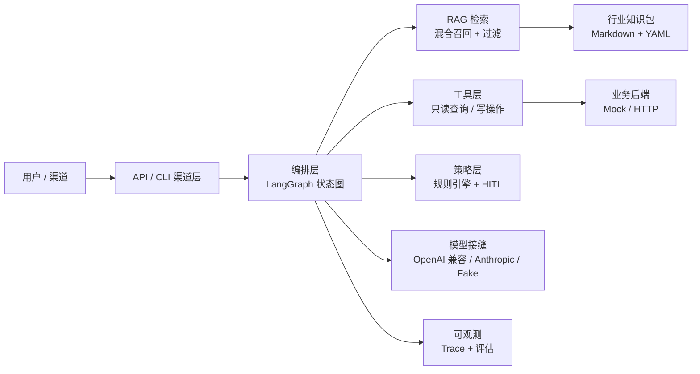

# ZeKe-Agent（知客 agent）

通用客服 / 业务办理 Agent：既能**回答**（基于企业知识库、带引用），也能**办理**（查订单、退款、报修、改地址、查物流），高风险动作走规则判定与人工审批。



## 项目简介

ZeKe-Agent 面向「客服问答 + 业务办理」一体化场景。用户一句话里既可能有知识型问题（保修怎么算、故障码什么意思），也可能有事务型诉求（查订单、退货、约安装）。这两类事情的处理方式完全不同：

- **知识型问题**走检索增强：六条用户链路的知识文档 + 结构化参数查询，回答必须带出处。
- **事务型诉求**走工具调用：查业务库、建工单、发起退款申请，写操作先过策略判定。

项目的核心不是让模型直接改业务数据，而是让 Agent 判断「这件事该怎么答、该调哪个工具、该不该转人工」，真正落库的动作仍由业务后端和审批流程完成。

架构上有一条硬判据：**换行业包、换业务后端时 Core 代码零改动；换模型或换检索实现时只替换两个接缝文件。** 因此三个行业包（`appliance` / `homeapp` / `3c`）共用同一套编排、策略与工具骨架，差异只在各自包内的知识、规则、提示词和种子数据。

## 核心能力

- **双层应答**：知识型问题走 RAG（带引用、依据核对），参数型问题走结构化查询（容量、能效、价格、库存不编造）。
- **知识按用户链路组织**：`presale` / `install` / `usage` / `troubleshoot` / `after_sales` / `repair_request` 六条链路，一篇文档只属一条链路，检索时按链路收窄。
- **混合检索**：向量召回 + BM25 召回 → RRF 融合 → 相似度闸门 → 三维过滤（链路 / 品类 / 型号）→ 可选精排，每一步的中间值都可观察。
- **工具调用与幂等**：订单、商品、物流、发票、工单等工具统一注册与参数校验，写操作带幂等键，失败重试有上限。
- **策略与 HITL**：声明式规则引擎（白名单算子、纯函数判定），命中高风险规则时挂起审批，`approvals approve` 后从检查点恢复继续执行。
- **上下文工程**：长会话按轮摘要压缩，工具载荷按 JSON 感知裁剪，保证 `tool_calls` 与 `tool` 消息不被拆散。
- **可观测与评估**：每次回答落 Trace；评估用例覆盖工具调用、文本、数据库终态、策略命中、Trace 与引用六类断言。
- **多行业包隔离**：业务库、检查点、索引、Trace 按行业分包存放，互不污染。

## 简版业务流程

以「订单 H2601 到货后不制冷，想退货」为例：

1. 用户在 CLI 或 HTTP 接口提交自然语言请求，携带 `user_id`。
2. 身份门禁先判定：未核验身份的查单请求被拒绝，并引导先核验。
3. 编排层合并会话历史与检查点，进入 LangGraph 状态图。
4. 意图路由判定属于哪条用户链路（故障排查 / 售后政策 / …），低置信时不收窄。
5. 需要知识时并行召回：向量候选 + BM25 候选 → RRF 融合 → 闸门 → 过滤 → 精排。
6. 需要业务事实时调用工具：`get_order`、`get_logistics`、`search_products` 等，只读工具直接执行。
7. 模型基于「当前业务数据 > 知识文档」的优先级生成回答或工具调用计划。
8. 有副作用或高风险的调用（退款、改地址、升级投诉）进入策略判定。
9. 命中规则则挂起，生成审批单并返回 `approval_id`，流程停在 `hitl_interrupt`。
10. 审批人执行 `approvals approve` 后 `chat --resume`，从检查点恢复，重新判定并继续。
11. 工具结果写回业务后端，Trace 记录模型、工具、检索、策略与审批。
12. 回答输出前做引用校验：引用必须来自本轮召回片段，必答数值必须核对。
13. 全过程写入 Trace，可通过接口或 `zkagent traces show` 回看。

决策优先级始终是：

```text
当前业务事实（工具查询） > 行业知识（文档） > 模型自身知识（禁止编造）
```

## 技术栈

后端：

- Python 3.12
- FastAPI / Uvicorn
- LangGraph（状态图与检查点）
- LlamaIndex（文档解析，仅用于检索，不启用其 Agent）
- SQLite（业务库、检查点、审批、幂等）
- sentence-transformers + BM25（本地向量与稀疏检索）

模型侧：

- OpenAI 兼容协议（DeepSeek / 通义 / 智谱 / 本地 vLLM / 自建网关）
- Anthropic Messages 协议
- Fake 脚本模型（无密钥验收与 CI）

工程能力：

- 声明式策略引擎 + 人工审批（HITL）
- 混合检索 + 精排 + 三维可见性过滤
- 上下文压缩与工具注入
- Trace / 评估 / 失败归因

## 目录结构

```text
zkagent/
  core/
    orchestrator/     编排：状态图适配器（唯一 import langgraph 的接缝）
    rag/              检索：引擎接缝、混合召回、过滤、精排、分块
    tools/            工具注册、参数校验、幂等与重试
    policy/           规则引擎、事实投影、审批状态机
    context/          历史压缩与工具载荷裁剪
    evals/            评估模型、断言、运行器、报告
    observability/    Trace 写入与读取
  backends/
    mock/             SQLite 模拟后端（订单、商品、工单、审批）
    http/             HTTP 后端适配（对接既有业务方言）
  channels/           渠道适配（CLI / API 共用载荷）
  industry_packs/     行业包：知识、规则、提示词、工具清单、种子数据
    appliance/        手写参考包（12 篇知识，无门禁）
    homeapp/          生成包（外部知识库搬入，含身份门禁与完整规则）
    3c/               第二行业包（手机 / 平板）

apps/
  cli.py              命令行入口（zkagent）
  api.py              FastAPI 服务
  flow.py             检索数据流面板（单页 HTML）
  legacy_api.py       旧系统方言模拟服务（演示 HttpBackend）
  build_kb_pack.py    把外部知识库打包成行业包
  pack_templates/     生成包的模板源（配置、规则、提示词、种子数据）

appliance-kb/         上游分层知识库（原始件与抽取中间产物不入库）
scripts/              数据生成、校准、验收脚本
tests/                单元 / 契约 / 端到端测试与阶段门禁脚本
```

## 快速开始

### 环境准备

需要 Python 3.12 与 pip；CPU 即可运行（向量模型本地加载，无需 API Key）。

```bash
python -m venv .venv && source .venv/bin/activate
pip install -U pip
# CPU 版 torch 先装，避免拉到 CUDA 依赖
pip install --index-url https://download.pytorch.org/whl/cpu torch
pip install -e ".[dev]"
```

配置密钥（可选，全部留空时自动落到 Fake 脚本模型）：

```bash
cp .env.example .env
# 按需填写 DEEPSEEK_API_KEY / OPENAI_API_KEY / DASHSCOPE_API_KEY 等
```

### 第一种跑法：手写包 appliance（开箱即用）

```bash
zkagent db reset && zkagent db seed      # 重建业务库并灌入种子数据
zkagent rag index                        # 建索引（首次全量，之后增量）
zkagent chat --provider fake --task "查订单 A1001" --user U1
```

### 第二种跑法：生成包 homeapp（含身份门禁与人工审批）

`homeapp` 的知识与种子数据是生成物，不入版本库，需要先重建：

```bash
python -m scripts.gen_homeapp_seed                                  # 生成业务数据
python -m apps.build_kb_pack --kb appliance-kb --pack homeapp        # 从外部知识库打包
zkagent --industry homeapp rag index                                 # 建索引（首次约数分钟）
zkagent --industry homeapp db seed                                   # 灌入独立业务库

# 未核验身份直接查单会被规则拒绝
zkagent --industry homeapp chat --provider fake --user H1 --task "查订单 H2601"

# 带上手机尾号核验后再查
zkagent --industry homeapp chat --provider fake --user H1 \
  --task "我是王芳，手机尾号 2046，查订单 H2601"

# 大额退款会挂起，返回审批单号，不会直接退款
zkagent --industry homeapp chat --provider fake --user H1 \
  --task "订单 H2618 质量问题，退全款 6999"
zkagent --industry homeapp approvals list
zkagent --industry homeapp approvals approve AP-XXXXXXXX --actor alice
zkagent --industry homeapp chat --resume AP-XXXXXXXX
```

> `--industry` 是全局参数，必须写在子命令之前；`--provider` / `--task` / `--user` 属于 `chat` 子命令。

### 第三种跑法：第二行业包 3c

```bash
zkagent --industry 3c db reset && zkagent --industry 3c db seed
zkagent --industry 3c rag index
zkagent --industry 3c chat --provider fake --task "查订单 B2001" --user U9
```

### 交互式数据流面板

一次回答是怎么拼出来的（召回、融合、闸门、过滤、精排、上下文、生成、校验），可以直接看中间值：

```bash
python -m apps.flow --pack homeapp --port 8010
# 打开 http://127.0.0.1:8010
```

面板默认先检索再生成；关掉「调用模型生成」就只跑检索链路，毫秒级返回。

### 检索与端到端评估

```bash
zkagent rag eval-retrieval --k 5          # Recall@k / MRR@k / nDCG@k 四配置对照
zkagent rag eval-retrieval --by-journey   # 按用户链路分组，看哪条链路弱
zkagent eval run --industry appliance --provider fake --out out/eval
zkagent traces show <trace_id>
```

## 部署方式

### Docker Compose（推荐用于联调）

Compose 会启动两个容器：`legacy`（旧系统方言服务，提供 `{code,msg,data}` 接口）和 `api`（FastAPI，默认 `ZKAGENT_BACKEND=http` 对接 legacy）。

```bash
docker compose up --build -d
curl -sf localhost:8000/health
```

调用对话接口：

```bash
curl -sf -X POST localhost:8000/chat \
  -H 'content-type: application/json' \
  -d '{"session_id":"s1","text":"查订单 A1001","user_id":"U1"}'
```

高风险请求会返回 `approval_id`，再查询与处理：

```bash
curl -sf localhost:8000/hitl/<approval_id>
curl -sf -X POST localhost:8000/hitl/<approval_id>/resolve \
  -H 'content-type: application/json' \
  -d '{"approved":true,"actor":"alice"}'
```

停止：

```bash
docker compose down
```

### 本地源码运行

```bash
# 业务方言服务
uvicorn apps.legacy_api:app --host 127.0.0.1 --port 8100

# Agent 服务（另开一个终端）
uvicorn apps.api:app --host 127.0.0.1 --port 8000
```

## 常用地址与接口

| 用途 | 地址 |
| --- | --- |
| 健康检查 | `GET /health` |
| 对话 | `POST /chat` |
| 查看审批单 | `GET /hitl/{approval_id}` |
| 审批处理 | `POST /hitl/{approval_id}/resolve` |
| Trace 回看 | `GET /traces/{trace_id}` |
| 渠道回调 | `POST /channels/{channel_id}/callback`（预留，返回 501） |
| 检索数据流面板 | `http://127.0.0.1:8010` |

## 支持的模型供应商

| 供应商 | 协议 | 默认模型 | 所需密钥 |
| --- | --- | --- | --- |
| `deepseek` | deepseek 官方集成 | `deepseek-chat` | `DEEPSEEK_API_KEY` |
| `openai` | OpenAI | 无（必须 `--model`） | `OPENAI_API_KEY` |
| `qwen` | OpenAI 兼容 | `qwen-plus` | `DASHSCOPE_API_KEY` |
| `zhipu` | OpenAI 兼容 | `glm-4-plus` | `ZHIPUAI_API_KEY` |
| `anthropic` | Anthropic Messages | 无（必须 `--model`） | `ANTHROPIC_API_KEY` |
| `ollama` | OpenAI 兼容 | 无（必须 `--model`） | 不需要 |
| `custom` | OpenAI 兼容 | 无（必须 `--base-url` + `--model`） | 不需要 |
| `fake` | 脚本化 | `fake-scripted` | 不需要 |

```bash
zkagent providers list                    # 只看密钥是否就位，不打印密钥值
zkagent chat --provider auto --task "查一下订单 A1001 的物流" --user U1
zkagent chat --provider custom --base-url http://localhost:8000/v1 \
             --model <本地模型名> --task "查一下订单 A1001 的物流" --user U1
```

新增一家 OpenAI 兼容供应商，只需在模型接缝的登记表里加一行数据，编排与工具代码不用改。

## 扩展一个行业包

1. 在 `zkagent/industry_packs/<id>/` 下建立 `pack.yaml`、`knowledge/`（按六条链路分目录）、`policies/rules.yaml`、`prompts/`、`tools.yaml`、`seed_data/`。
2. 知识文档用 front-matter 标注品类与型号，参数类事实交给结构化工具，文档只写「怎么选、怎么装、怎么修」。
3. `zkagent --industry <id> db seed && zkagent --industry <id> rag index`。
4. 业务库、检查点、索引按行业分包存放，默认包用 `data/business.db`，其他包用 `data/business-<id>.db`。

换业务后端只需实现同一个后端协议（`mock` 与 `http` 两套实现可参照），Core 与行业包都不需要改动。

## 测试与检查

```bash
pytest -q                                  # 全量测试
python -m compileall -q apps zkagent tests # 语法检查
bash tests/gates/run_p4.sh                 # 阶段门禁脚本（P0 ~ P7，单文件，取消注释跑单点）
```

约定：测试不依赖真实网络与真实密钥；需要模型的地方用 `fake` 脚本模型，需要外部资源的地方注入替身。

## 说明

本项目强调「可解释、可审批、可回归」：Agent 负责判断、检索、生成与编排，真正的业务写入仍由业务后端与人工审批流程完成。回答必须能追到出处，动作必须能追到规则与审批记录。
